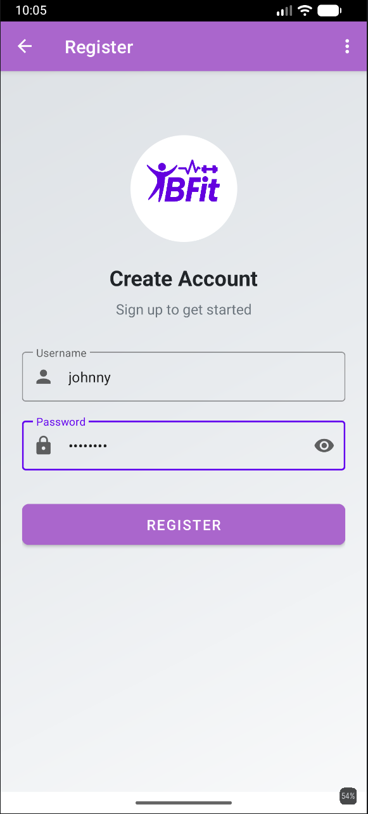
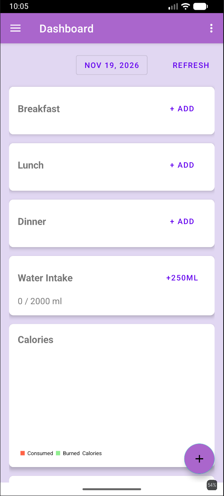
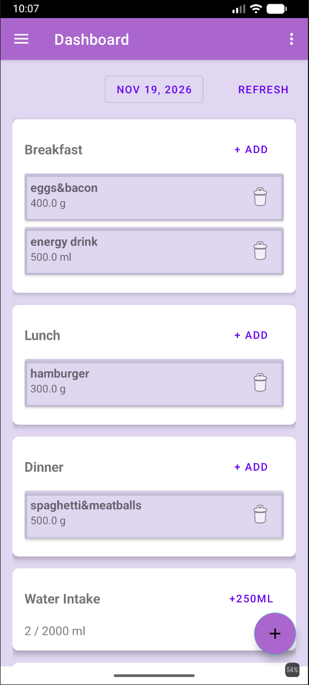
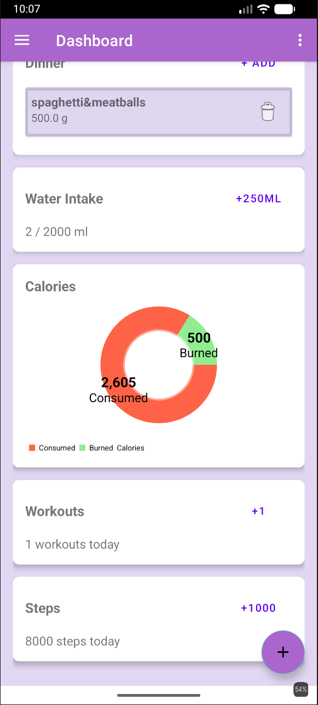
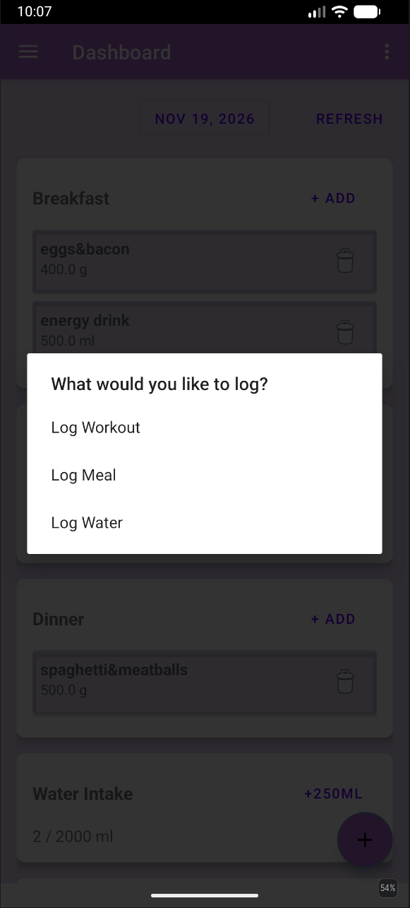
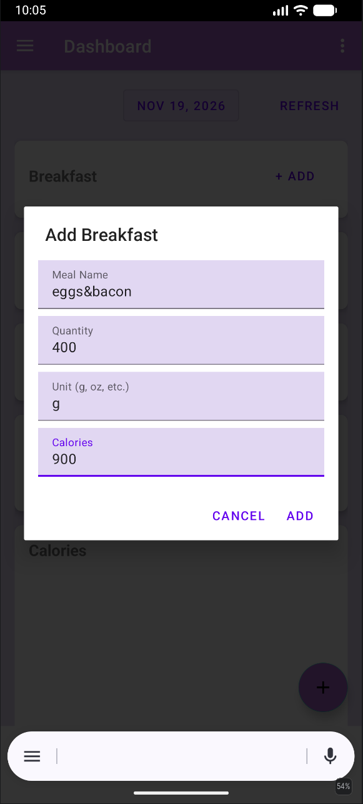
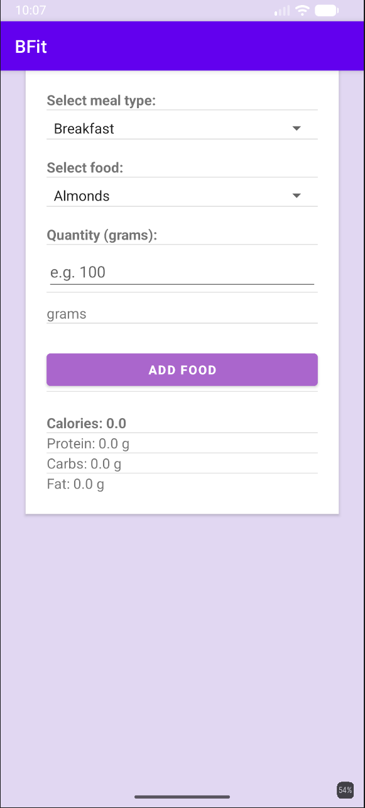
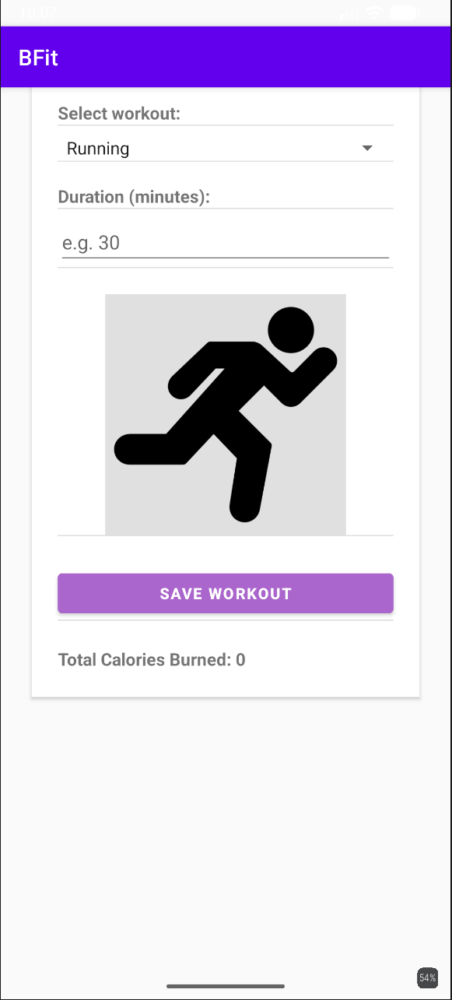
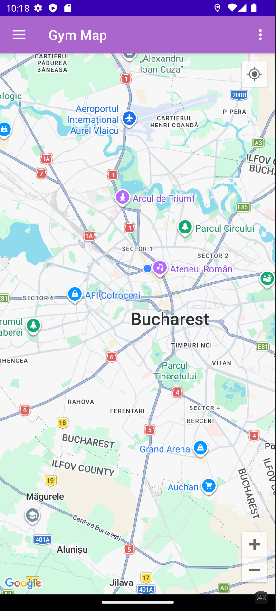
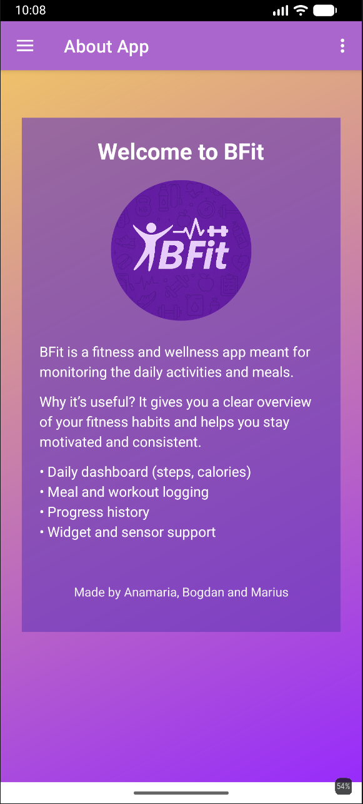

# 💪 BFit

> A fitness and wellness app for monitoring your daily activities and meals.

**BFit** gives you a clear overview of your fitness habits and helps you stay motivated and consistent. Log your meals, workouts, and water intake, then see how your day adds up on a single dashboard.

*Made by Anamaria, Bogdan and Marius*

---

## ✨ Features

- **Account registration**: create an account with a username and password
- **Daily dashboard**: pick a date and see everything you logged, with steps and calories at a glance
- **Meal logging**: add food to Breakfast, Lunch, or Dinner with a name, quantity, unit, and calories, and delete entries you no longer want
- **Food picker**: choose a meal type and a food, enter the quantity in grams, and see calories, protein, carbs, and fat
- **Workout logging**: select a workout, enter the duration, and track the calories you burned
- **Water tracking**: add 250 ml at a time toward a daily goal of 2000 ml
- **Calorie chart**: a consumed vs. burned breakdown
- **Gym map**: a Google Maps view with your current location, plus locate and zoom controls
- **Quick-log button**: one tap to log a workout, meal, or water from anywhere on the dashboard
- **Progress history, widget and sensor support** (as described on the in-app About screen)

---

## 📱 Screenshots

*Captured on the Android Emulator.*

### Getting Started

| Register |
|:---:|
|  |

### Dashboard

Start with an empty day, then watch it fill up as you log meals, water, workouts, and steps.

| Empty day | Meals logged | Daily summary |
|:---:|:---:|:---:|
|  |  |  |

### Logging

Tap the **+** button to choose what to log, or use **+ ADD** on any meal card.

| Quick-log menu | Add a meal |
|:---:|:---:|
|  |  |

| Log food | Log workout |
|:---:|:---:|
|  |  |

### Gym Map

| Gym Map |
|:---:|
|  |

### About

| About BFit |
|:---:|
|  |

---

## 👩‍💻 Authors

Made by **Anamaria**, **Bogdan** and **Marius**.
